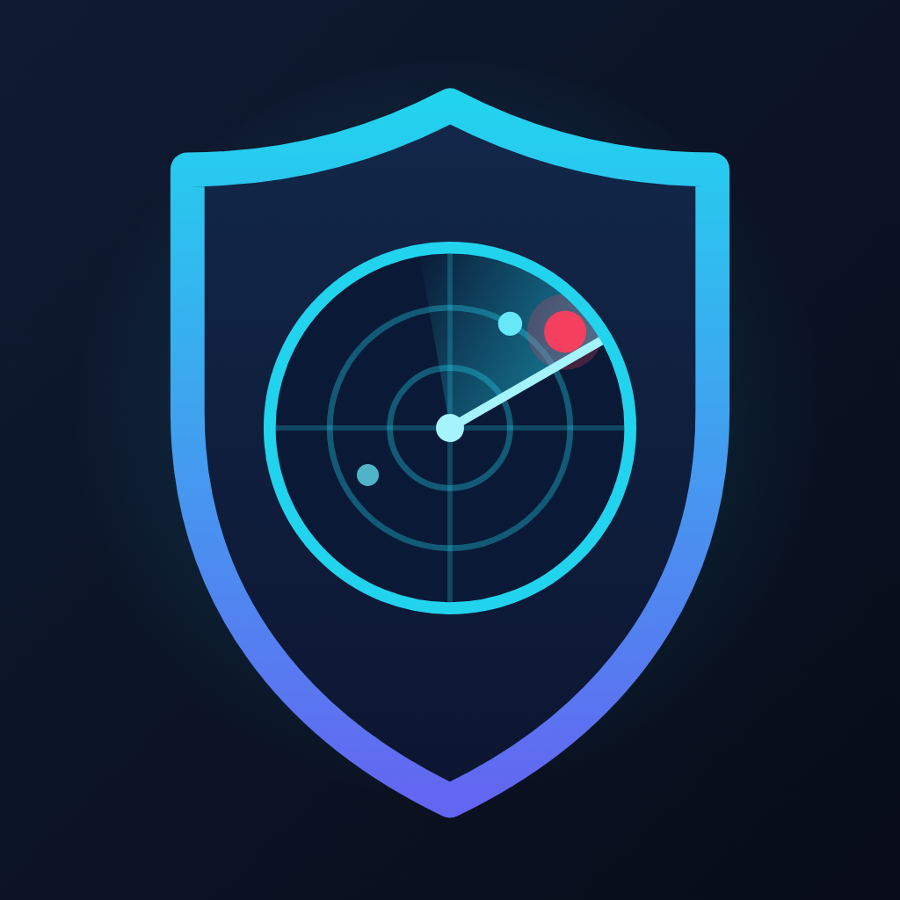

# Sentinel

A security and tech-news radar for developers, in Slack and on a daily web page.
**Brief page:** https://dev-kartik-sharma.github.io/tech-digest/

<br clear="left" />

It watches security advisories and tech news for these tech areas:

| Tech area (digest category) | Covers |
|---|---|
| PHP | PHP, Laravel, Symfony, WordPress, Drupal, Composer packages |
| JS / Node | Node.js, Express, NestJS, React, Next.js, Angular, Vue (MERN / MEAN), every npm package |
| Python | Python, Django, Flask, FastAPI, PyPI packages |
| Database | PostgreSQL, MySQL / MariaDB, MongoDB, Redis, SQLite, plus their client libraries (`pg`, `mysql2`, `mongoose`, `ioredis`, `predis`…) |
| Nginx / web server | nginx, NGINX Plus |
| Third-party services | Providers you integrate with API keys and SDKs: SendGrid, Twilio, Mailchimp, Mailgun, Postmark, Stripe, PayPal, Razorpay, Auth0, Okta, Google sign-in, Firebase, Sentry, Algolia, Cloudinary. A breach at one of them lands here, with what to rotate. Flaws in their SDKs (`@sendgrid/mail`, `twilio/sdk`, `stripe`, `google-auth-library`…) are filed under the SDK's language |
| Infrastructure | GitHub (incl. Enterprise Server, Actions), GitLab, Docker (Engine, Desktop), Kubernetes, containerd / runc, and hosting platforms: Vercel, Netlify, Supabase, Heroku, Cloudflare |
| Cloud | AWS (security bulletins), plus Azure and Google Cloud mentions |
| AI models & tools | New models and capabilities from Anthropic (Claude), OpenAI (ChatGPT / GPT), Google (Gemini, DeepMind), open-weight models (Hugging Face), and developer AI tools and workflows (Copilot, Cursor, Claude Code, MCP); security issues in AI tools get their own *AI tools vulnerability* category |

On top of those, news is also grouped as *exploited in the wild*, *supply chain*, *breach / malware*,
*release / update* and *tech news*.

**In Slack** (kept short for busy developers):
- **Critical alerts, instantly:** e.g. a PHP or Next.js remote code execution bug, or anything in your
  stack on CISA's actively-exploited list, with affected versions and the version to upgrade to.
  Python criticals are the exception: they skip the instant alert and only appear in the daily brief
  (`briefOnlyCategories` in `src/config/sources.ts`).
- **One daily brief** on the first run after 10:00 IST (usually by ~10:15). It has the day's counts, the
  top 5 High items (one line each, spread across tech areas) and an **Open today's brief** button.
  Criticals that were already alerted are only counted. Link previews are turned off.

**On the brief page** (GitHub Pages): everything from that day, grouped by priority and then category,
with filters by priority and tech area, search, an AI summary and an "upgrade to X" line per item,
affected versions, and the last 30 days of history. It follows your light/dark setting and works on phones.

**What "new" means:** each day's brief contains what the bot first saw since the previous brief, i.e.
roughly the last 24 hours. Every item appears once. Almost everything was published in the last 1–2
days. The exception is NVD, which sometimes finishes analysing an older CVE (up to 30 days old) and only
then links it to a product like PHP or nginx; the page shows each item's publish date.

It runs on **GitHub Actions**, triggered hourly by a free external scheduler (cron-job.org), with no
server and no cloud account. It uses your **Gemini AI Studio
free-tier key** for short summaries: one batched request per poll, and only when something new arrived
(up to 3 on a busy first run).

## How it works

```
cron-job.org (hourly) ──┐
GitHub cron (every 2h) ─┴─▶ workflow `auto`
  1. poll:    fetch sources → merge duplicates → popularity lookup → rule-based score
              → drop already-seen → 1 batched Gemini call → critical? alert now; queue everything for the day
  2. publish: past DIGEST_AFTER (10:00 IST) and today's not done yet?
              → archive the day → build the page → deploy to GitHub Pages → then post the Slack brief
```

State is `state.json` (items already handled, kept 45 days, plus the day's queue) and one
`days/<date>.json` per published brief (the last 30, which the page is built from). The workflow keeps
them on a `state` branch as a **single force-pushed commit**, so repo history doesn't grow. Runs never
overlap (there's a concurrency group), and if a run fails partway, the state it reached is still saved, so
alerts already posted are never sent again.

| Source | What it gives |
|---|---|
| GitHub Advisory DB (npm, composer, pip) | Package vulnerabilities, with CVSS and affected/fixed versions |
| NVD (PHP, Node.js, Python, PostgreSQL, MySQL, MariaDB, MongoDB, Redis, SQLite, nginx, GitLab, GitHub Enterprise Server, Kubernetes, runc, Docker Engine, Docker Desktop) | CVEs in the products themselves |
| CISA KEV | Vulnerabilities being actively exploited |
| Node.js security, php.net, Python Insider, Django, PostgreSQL, nginx.org, GitLab security releases, AWS security bulletins | Official security releases |
| The Hacker News, BleepingComputer, GitHub Security Blog | Security news |
| Laravel News, Node.js / React / Angular / MongoDB blogs, HN front page (300+ pts) | Dev and tech news |
| Anthropic news (via its sitemap: no RSS), OpenAI, Google AI, Google DeepMind, Hugging Face, GitHub AI & ML, Simon Willison, Latent Space, TechCrunch AI | AI models, benchmarks and developer AI tools |

**Priority rules** (deterministic, so alerts still work if Gemini is down). They live in `src/pipeline/score.ts`:

- **Critical:** in your stack and either on CISA KEV, or CVSS ≥ 9, or an RCE in a runtime or a popular package.
  "Popular" means ≥ 50k downloads (npm / PyPI per week, Packagist per month) or listed in `MAJOR_PACKAGES`.
- **High:** in your stack with CVSS ≥ 7, or on KEV but outside your stack, or security news about
  your stack being actively exploited or hit by RCE or supply-chain attacks.
- **Medium / Low:** lower CVSS bands, and general security and tech news.
- Advisories for packages with fewer than 1k downloads are dropped as noise.
- Without a Gemini key, all security and tech news is kept (as low unless it touches your stack), and
  the digest caps keep the volume in check.
- When CISA adds a CVE to KEV, the bot looks up the GitHub advisory for that CVE, so a package
  vulnerability is recognised as in-stack even when the KEV text never mentions npm or PHP.
- An item matching several areas gets the first one in the table above (e.g. "PHP app on AWS" → PHP).
- AI posts: launches, new capabilities and benchmark results are medium; other AI posts are low. Gemini
  summarises what launched, its key capabilities, benchmark scores **only when the article states them**,
  and how to try it, and filters out funding / IPO / lawsuit stories.
- Gemini writes the summaries and ends each with a concrete next step, e.g. "Upgrade laravel/framework to
  13.29.0 or later".
- For **news only**, Gemini can also change the category, raise the priority by one
  level, or drop promotional posts. It never changes a vulnerability's priority.

## Setup

### 1. Keys (all free)

| Key | Where to get it | Required? |
|---|---|---|
| Slack webhook URL | api.slack.com/apps → Create app → Incoming Webhooks → add to your channel | yes |
| Gemini API key | aistudio.google.com → Get API key | recommended |
| NVD API key | nvd.nist.gov/developers/request-an-api-key | recommended: without it, NVD's rate limit adds ~2 min to each run (19 product queries) |

There's no GitHub token to create: the workflow's built-in `GITHUB_TOKEN` is used for the Advisory API.
For local runs you can set `GITHUB_TOKEN` in `.env` to raise the API rate limit.

### 2. Try it locally

```bash
npm install
cp .env.example .env              # fill in what you have
npm test
npm run local -- --dry-run        # real feeds, prints Slack messages instead of sending them
npm run local -- --dry-run --lookback-hours=120   # look back 5 days to see more
npm run local                     # actually posts (point SLACK_WEBHOOK_URL at a test channel)
python3 -m http.server -d site 8080   # then open http://localhost:8080 to preview the brief page
```

### 3. Run it on GitHub Actions

1. Push this project to a GitHub repo, and turn on Pages: **Settings → Pages → Source: GitHub Actions**.
2. **Settings → Secrets and variables → Actions → Secrets:** add `SLACK_WEBHOOK_URL`, `GEMINI_API_KEY`
   and, optionally, `NVD_API_KEY`.
3. **Same page → Variables** (optional): `DIGEST_TIMEZONE` (default `Asia/Kolkata`), `DIGEST_AFTER`
   (local time the daily brief may go out, default `10:00`), `DAYS_KEPT` (history on the page, default 30),
   `SITE_URL` (only for a custom domain), `GEMINI_MODEL`.
4. Set up the hourly trigger (below).
5. **Actions tab → tech-updates → Run workflow** (`auto`) for the first run and check the channel.
   You can also run `poll` or `digest` by hand; a manual `digest` publishes now and counts as that day's.

The first poll looks back 48 hours. It sends at most 5 instant alerts, and anything beyond that goes into
the day's queue. Running it again right away should post nothing, because those items are now marked as seen.

Manual runs on your machine use the same state format: `npm run auto`, `npm run poll` and
`npm run digest`, with state kept in `state/state.json`.

### 4. Hourly trigger with cron-job.org

1. **Create a token** that can only start this repo's workflows: GitHub → Settings → Developer settings →
   Fine-grained tokens → Generate new token.
   - Repository access: *Only select repositories* → this repo.
   - Permissions → Repository → **Actions: Read and write** (nothing else).
   - Expiration: up to 1 year; set yourself a reminder to renew it.

   It can start or cancel this repo's workflow runs, but it can't read secrets or change code.
2. **Create a cron job** at cron-job.org (free account):
   - URL: `https://api.github.com/repos/<owner>/<repo>/actions/workflows/tech-updates.yml/dispatches`
   - Schedule: every hour (e.g. at minute 15), time zone Asia/Kolkata.
   - Advanced → Request method **POST**, headers:
     - `Authorization: Bearer <token>`
     - `Accept: application/vnd.github+json`
     - `X-GitHub-Api-Version: 2022-11-28`
     - `Content-Type: application/json`
   - Request body: `{"ref":"main","inputs":{"command":"auto"}}`
   - Notifications: on failure. GitHub answers **204 No Content** on success.
3. Press **Test run** and check that a new `workflow_dispatch` run appears in the Actions tab.

## Tuning

Everything you're likely to change is in `src/config/sources.ts`: feeds, stack keywords, `MAJOR_PACKAGES`,
popularity thresholds, days of history, and the Gemini batch size and call limits. Run `npm test` after changing it.

## Layout

```
src/config/sources.ts     feeds, CPEs, keywords, thresholds
src/sources/              one fetcher + pure parser per source
src/pipeline/             normalize, dedupe, popularity, score, enrich-gemini
src/slack/                Block Kit formatting + webhook posting
src/store/                Store interface, in-memory store, JSON file store
src/handlers/             runAuto / runPoll / runDigest (dependencies injected, so they're testable offline)
src/site/                 brief page: build.ts writes data JSON; static/ has index.html, style.css, app.js
src/main.ts               entry point used by the workflow: `auto` | `poll` | `digest`
scripts/run-local.ts      preview runner (in-memory state)
.github/workflows/        triggers (external + backup cron), state restore/save
```
